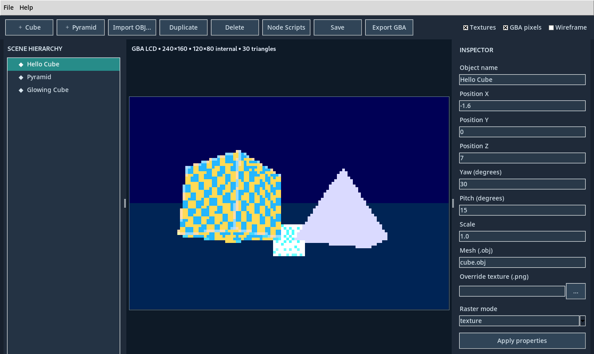
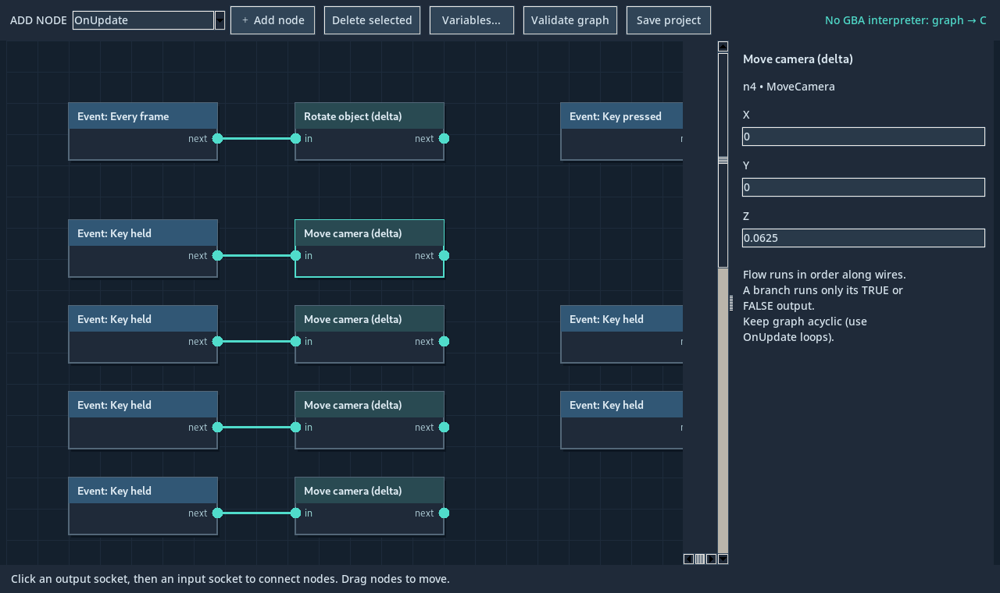

## Universal Nodes 3.0 preview

See [Universal Nodes 3.0 Guide](docs/UNIVERSAL_NODES_3.md) for dynamic object references, generic spatial queries, reusable function libraries, custom events and the Mini Golf diagnostic project.

# SG3D Studio

**A lightweight visual 3D game engine targeting the Nintendo Game Boy Advance.** Build scenes, import low-poly OBJ meshes, attach unrestricted user-authored C component scripts or connect node graphs, and export native GBA ROMs.

> **Release status: private-source release candidate.** This repository includes modified code derived from [Tobias Friedly's `smg-gba`](https://github.com/TobiasFriedly/smg-gba), which did not have a verified redistribution license when this package was prepared. Keep the repository **private** unless the relevant rightsholders grant permission for a public source release. See [LICENSE_STATUS.md](LICENSE_STATUS.md). **No open-source license is claimed for the full codebase.**



## Features

- Optimized ARM assembly software triangle rasterizer, 120×80 internal 3D framebuffer (scaled to GBA display)
- Visual scene editor and approximate PC play preview (Python + Tkinter)
- OBJ/MTL/PNG import, texture atlas conversion, flat/textured materials
- **Universal Nodes 2.0 preview:** typed number/Boolean/vector sockets, bounded loops, reusable function graphs, numeric arrays and genre-neutral object/camera/physics nodes compiled into native C
- **Universal scripting preview:** attach your own compiled C components to any object, create empty logic-only objects, and define numeric properties shared with node graphs
- Multiple scenes, scene switching, global variables, collision and jumping
- Smooth character facing, camera-relative orbit controls, arcade vehicle controller
- Panoramic sky background, rigid-transform animations, short WAV playback
- Native-resolution HUD text/icons via GBA sprites, plus counters, bars and dialogue panels
- Save/load, project validation, embedded assets in a self-contained project, export to `.gba`



## Quick start (Windows)

1. Install [Python 3](https://www.python.org/downloads/) (with Tkinter) and [Pillow](https://pypi.org/project/pillow/): `py -3 -m pip install -r requirements.txt`.
2. Extract the repository contents and double-click **`RUN_EDITOR.bat`** (or run `python editor/visual_editor.py`).
3. Open `examples/universal_nodes2_explore.sg3d.json` or `examples/universal_nodes2_drive.sg3d.json`, `examples/orbit_sky_demo.sg3d.json`, or `examples/collectathon_v12.sg3d.json`.
4. Edit the scene, save your project, click **Play** for an approximate PC preview, and choose **Export GBA** to build a ROM.
5. Building a ROM also requires **devkitARM** (`arm-none-eabi-gcc`, `arm-none-eabi-objcopy`), or **Clang + LLD + llvm-objcopy** in PATH. No Mario Galaxy ISO is required.

See the [Node Scripting 2.0 Guide](docs/UNIVERSAL_NODES_2.md), [Universal Scripting Guide](docs/UNIVERSAL_SCRIPTING.md) and [Getting Started](docs/GETTING_STARTED.md) for step-by-step commands, and [Controls & Editor](docs/EDITOR_AND_NODES.md) for details.

## CLI build

```sh
python -m pip install -r requirements.txt
python tools/project_check.py examples/collectathon_v12.sg3d.json
python tools/project_export.py examples/collectathon_v12.sg3d.json
python build.py --main generated/main.c --output build/collectathon.gba
```

Generated files and ROM builds are deliberately **not committed**. You can also run `BUILD_EXAMPLE.bat` on Windows.

## Tests

```sh
python -m unittest discover -p 'tests*.py'
```

Some tests invoke a native ARM compiler or GUI. On Linux, run GUI tests under `xvfb-run -a`. A [GitHub Actions workflow](.github/workflows/tests.yml) is included.

## Hardware and limitations

- Target hardware: GBA / GBA-compatible mode; mGBA is useful for debugging. The PC preview is not cycle-accurate.
- The 3D framebuffer is 120×80; the 2D HUD can use 240×160 hardware sprites.
- Basic AABB collision only; no reliable slopes, rotated colliders, or moving platform physics.
- Audio is one short 8-bit PCM effect at a time; no general-purpose music mixer.
- 3D animation uses baked rigid transforms (not skinning). No cartridge save system yet.
- Custom C scripts currently execute only in the exported GBA ROM, **not** in the desktop Play preview. Node scripting is more expressive now but still has bounded loops, fixed-size numeric arrays, and limited function signatures.
- Performance depends on scene geometry, screen coverage, and texture fill; split scenery into independently cullable objects.

## Source credits, rights, and publishing

SG3D is an independent editor/runtime assembled around extracted and modified renderer code from **Tobias Friedly / Game of Tobi's Super Mario Galaxy GBA project**, which acknowledges earlier work by Joshua Barretto and other sources. Thanks to the original authors for their technical work. The exact rights of all copied/derived portions need verification before **public redistribution**.

**Do not add an MIT/GPL license covering the whole repository or publish this source as public open source until permission and all third-party licenses are confirmed.** See [Attribution & provenance](THIRD_PARTY_NOTICES.md) and [Release checklist](docs/RELEASE_CHECKLIST.md).

SG3D does not include assets from commercial Nintendo games, nor does it require a game ISO.
